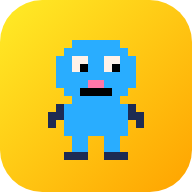
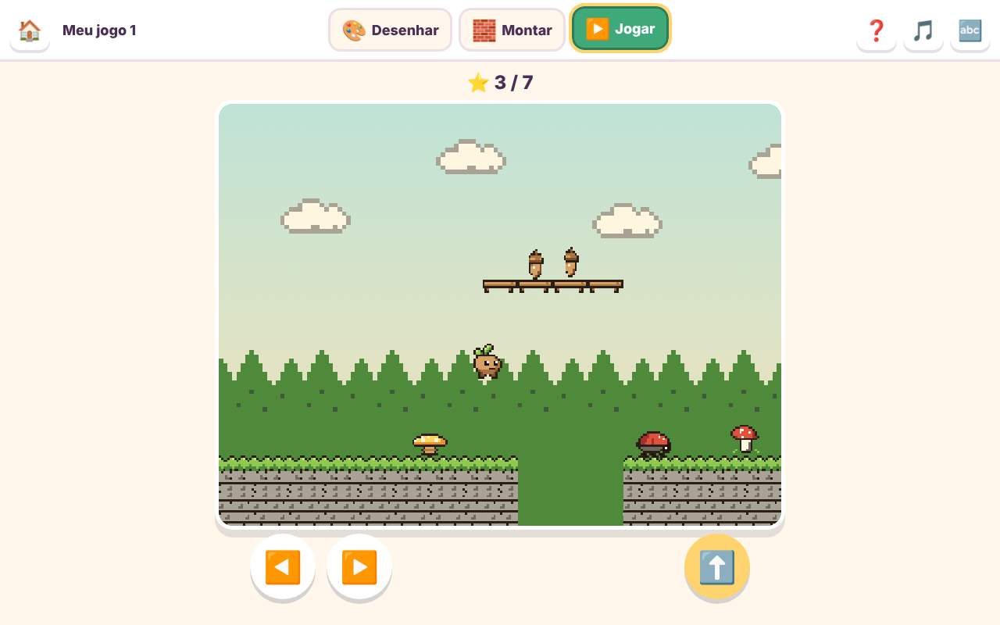
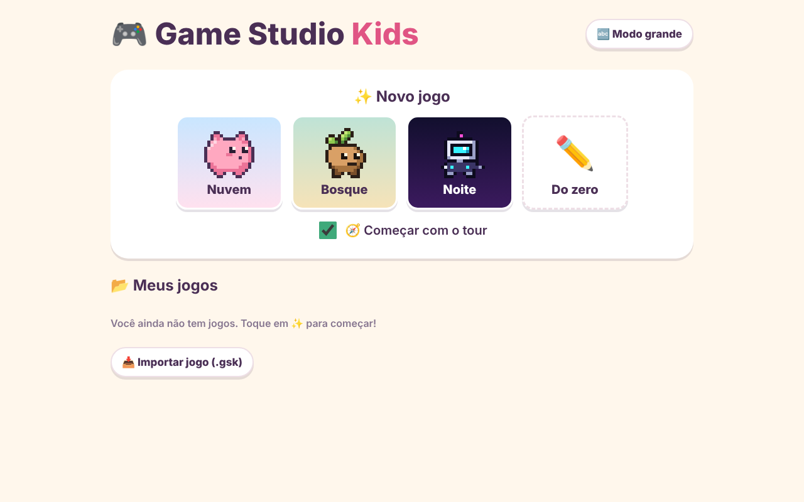
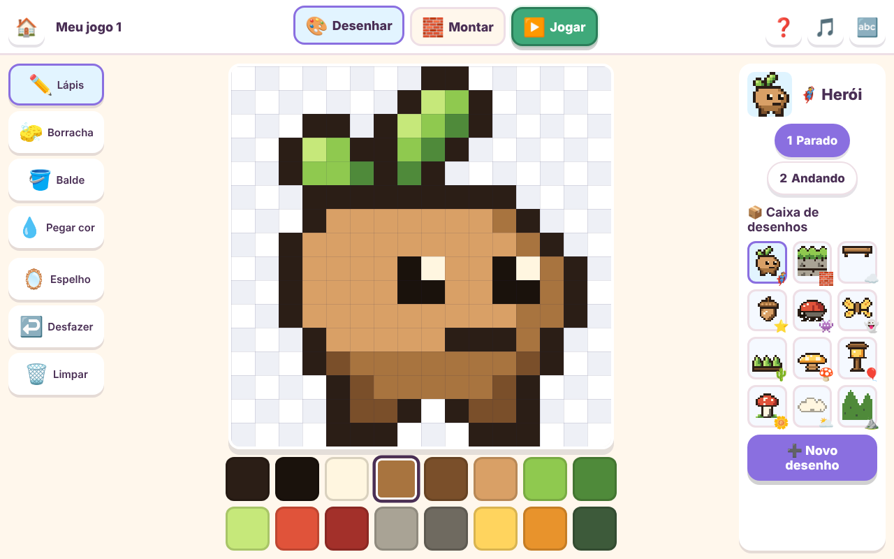
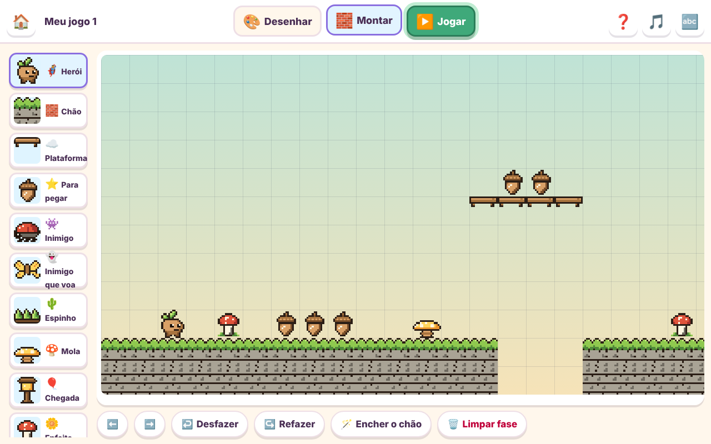

<p align="center">
  
</p>

<h1 align="center">Game Studio Kids</h1>

<p align="center"><strong>Draw it. Build it. Play it.</strong></p>

<p align="center">
  <a href="https://gamestudio42.github.io/gamestudio-kids/"></a>
  <a href="https://github.com/gamestudio42/gamestudio-kids/deployments/github-pages"></a>
  <a href="https://github.com/gamestudio42/gamestudio-kids/stargazers"></a>
  <a href="https://github.com/gamestudio42"></a>
</p>

<p align="center">
  A 2D game maker for children aged five and up, for tablets and computers. Children paint
  their own pixel-art characters, place them in a level and play the game they made. Pixo, a
  friendly mascot, guides the first game step by step and reads every instruction aloud.
  No installation or account is needed, and it works offline once opened.
</p>

<p align="center">
  <a href="https://gamestudio42.github.io/gamestudio-kids/">
    
  </a>
</p>

<p align="center">
  <a href="https://gamestudio42.github.io/gamestudio-kids/">
    
  </a>
</p>

## From a drawing to a game

1. **Pick a world.** Nuvem (Pom, a pastel cloud cat), Bosque (Broto, a forest sprout) and Noite
   (Bip, a night-time robot) each open with every drawing and a level ready to play. "Do zero"
   starts with an empty level.
2. **Draw.** Paint on a 16×16 grid with pencil, eraser, bucket, colour picker, mirror and undo.
   Every drawing in the game can be changed, and new ones get a type: hero, ground, platform,
   collectable, walking or flying enemy, spikes, spring, finish, decoration, sky cloud or hill.
3. **Build.** Tap or drag a drawing onto the 40×12 level. Fill the ground in one tap, scroll the
   level and undo or redo any change.
4. **Play.** Run, jump and collect stars. Jump on enemies to defeat them, bounce high on springs
   and reach the finish. A fall or a hit sends the hero back to the last safe ground.

Heroes, enemies and ground have a second drawing for walking and edges; the first drawing shows
faintly behind it as a guide. Questions such as "delete this game?" use large icons and are read
aloud, so children who cannot read yet can still answer.

## See the studio

<p align="center">
  
</p>

<table>
<tr>
<td align="center" width="50%" valign="top">
<br>
Paint any drawing, with a second frame for walking.
</td>
<td align="center" width="50%" valign="top">
<br>
Place drawings on the level, then press play.
</td>
</tr>
</table>

## Play

Open **[gamestudio42.github.io/gamestudio-kids](https://gamestudio42.github.io/gamestudio-kids/)**.
The interface is in Brazilian Portuguese, with large icons and spoken instructions.

| Action                    | Keys                          |
| ------------------------- | ----------------------------- |
| Walk                      | `←` `→` or `A` `D`            |
| Jump                      | `↑`, `W` or `Space`           |
| Undo / redo (draw, build) | `Ctrl+Z` / `Ctrl+Y`           |

On a tablet, large on-screen buttons walk and jump. 🔤 switches between big buttons with labels
and an icon-only mode for the youngest players; 🎵 turns the music off.

Games save themselves in the browser. **Guardar cópia** downloads every game as one `.gsk` file,
and **Importar jogo** brings them back; the home screen reminds you when a game has changed
since the last copy. To install the studio as an app, open the site and choose
**📲 Instalar no aparelho** (Chrome, Edge, Android) or *Share → Add to Home Screen* (iPad, iPhone).

## Develop

There is no build step: the studio is plain JavaScript, HTML and CSS, and `index.html` also
opens straight from disk. To test on a tablet on the same network, serve the folder:

```sh
python3 -m http.server 8000   # then open http://YOUR-COMPUTER-IP:8000
```

| Path                  | Purpose                                                       |
| --------------------- | ------------------------------------------------------------- |
| `js/data.js`          | Palettes, drawing types, worlds, starter art, saving, sounds  |
| `js/pixel-editor.js`  | Pixel editor with frames and onion skin                       |
| `js/level-editor.js`  | Level editor with undo and redo                               |
| `js/game.js`          | Platform engine: physics, enemies, springs, checkpoints       |
| `js/tour.js`          | Pixo's interactive tour                                       |
| `js/app.js`           | Home screen, tabs, questions, backup, import and export       |
| `sw.js`, `js/pwa.js`  | Offline cache and the install button                          |

GitHub Pages serves the `main` branch as it is. A project is a single JSON document, so the
level already records its view (`lado`, side-on) to make room for top-down levels later.
For older children there is a companion studio with rules, several levels and HTML export.
The original Portuguese notes are in [docs/LEIA-ME.md](docs/LEIA-ME.md).

## Licence

Game Studio Kids is free software under the GNU Affero General Public License, version 3 or any
later version ([`AGPL-3.0-or-later`](LICENSE)), following the
[Game Studio 42](https://github.com/gamestudio42) default for complete games. If you run a modified
version for other people, including as a website or over a network, you must offer them its source
under the same licence. Copyright (c) 2026 Marcel Savegnago.

Its code, pixel art, sound and music are original.
